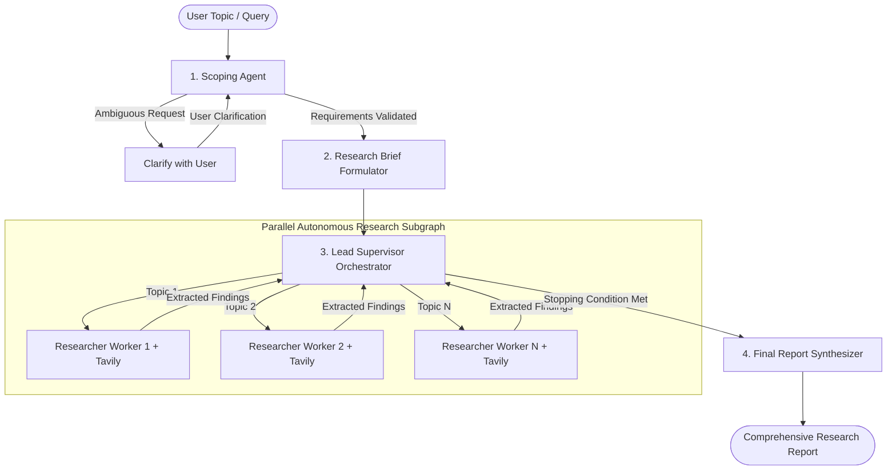

# 🔬 Deep Research Agent

> **An Autonomous Multi-Agent Literature, Fact-Checking & Web Intelligence System built with LangGraph, Google Gemini, and Tavily.**

---

## 🌟 Overview

**Deep Research Agent** is an enterprise- and academic-grade autonomous research platform. Unlike standard single-turn LLM prompts or naive retrieval-augmented generation (RAG), this system orchestrates a **hierarchical, cyclic state machine** across specialized autonomous agents to scope topics, clarify ambiguities, execute parallel web searches, and synthesize comprehensive, citation-backed executive research reports.

---

## 🏛️ Multi-Agent Architecture

The architecture is implemented in **LangGraph**, combining deterministic structured outputs with dynamic multi-agent execution loops:



### The 5 Pipeline Components:

1. **🎯 Scoping Agent (`clarify_with_user`)**: Evaluates user prompts using structured Pydantic schemas. If a query is overly ambiguous, it halts and interactively requests clarification from the user rather than hallucinating.
2. **📋 Research Brief Formulator (`write_research_brief`)**: Transforms conversation history into an exhaustive, structured research brief with temporal grounding and explicit validation criteria.
3. **⚙️ Supervisor Orchestrator (`supervisor_agent`)**: Analyzes the brief and coordinates autonomous research sub-tasks.
4. **🔍 Parallel Researcher Units (`researcher_agent`)**: Dispatches concurrent research tasks with Tavily Search and ReAct reasoning to gather evidence and compress raw findings.
5. **✍️ Final Report Synthesizer (`final_report_generation`)**: Ingests all deduplicated notes and compiles an academic-grade markdown report complete with executive summary, comparative analysis, and citations.

---

## 💻 Streamlit Web Application

The project includes an interactive, professional **Streamlit** user interface:

- **Sidebar Configuration Panel**:
  - **🔧 Models Configuration**: Independent selection for Final Report Generation and Supervisor orchestration models (`gemini-3.5-flash-lite`, `gemini-2.5-flash`).
  - **🔍 Search & Research Parameters**:
    - Toggle *Allow Clarification Questions*
    - Slider *Max Concurrent Researchers* (1 – 5)
    - Slider *Supervisor Max Iterations* (1 – 5)
    - Slider *Max Tool Calls / Researcher* (1 – 10)
  - **🔑 Live Service Status**: Real-time validation badges for Gemini and Tavily API credentials.
- **Main Research Studio**:
  - Suggested topic pills for quick testing.
  - Live progress cards tracking each agent stage in real time.
  - Interactive clarification dialog if the scoping agent requests more details.
  - Final report reader with execution KPIs (Elapsed Time, Evidence Units, Word Count) and **📥 Download (.md)** support.
- **Architecture Presentation Tab**:
  - Embedded Mermaid architecture diagram and theoretical breakdown for academic evaluations and project guide reviews.
- **Session History Tab**:
  - Search history persisted locally for quick review and report export.

---

## 🚀 Quick Start

### 1. Prerequisites
- Python 3.10+
- [uv](https://github.com/astral-sh/uv) (recommended) or standard Python `venv`
- Google Gemini API Key: [Google AI Studio](https://aistudio.google.com/app/apikey)
- Tavily API Key: [Tavily Search](https://app.tavily.com)

### 2. Installation

Clone the repository:
```bash
git clone https://github.com/Balavishvas/DeepResearchAgent.git
cd DeepResearchAgent
```

Install dependencies using `uv`:
```bash
uv sync
```

### 3. Environment Configuration

Copy the example environment file and add your API keys:
```bash
cp .env.example .env
```

Edit `.env`:
```env
GOOGLE_API_KEY=your_gemini_api_key_here
TAVILY_API_KEY=your_tavily_api_key_here
```

### 4. Launch the Application

Run the Streamlit application:
```bash
uv run streamlit run app.py
```

The application will be accessible at `http://localhost:8501`.

---

## 📂 Project Structure

```
DeepResearchAgent/
├── app.py                      # Streamlit interactive application
├── deep_research/
│   ├── agents/
│   │   ├── __init__.py         # Agent exports
│   │   ├── scoping_agent.py    # Clarification and Research Brief agent
│   │   ├── supervisor_agent.py # Lead supervisor & parallel researcher graph
│   │   ├── research_agent.py   # ReAct Tavily web search agent
│   │   └── full_agent.py       # Compiled end-to-end LangGraph pipeline
│   ├── prompt.py               # Prompt templates & guidelines
│   ├── state.py                # Pydantic schemas & TypedDict state definitions
│   └── utils.py                # Search tools & formatting utilities
├── notebooks/                  # Interactive development & testing notebooks
├── pyproject.toml              # Project dependencies and packaging
└── README.md                   # Project documentation
```

---
## To run this
cd d:\DeepResearchAgent\DeepResearchAgent
.\.venv\Scripts\Activate.ps1
python -m http.server 8000
http://localhost:8000

## 📜 License

This project is licensed under the MIT License.
